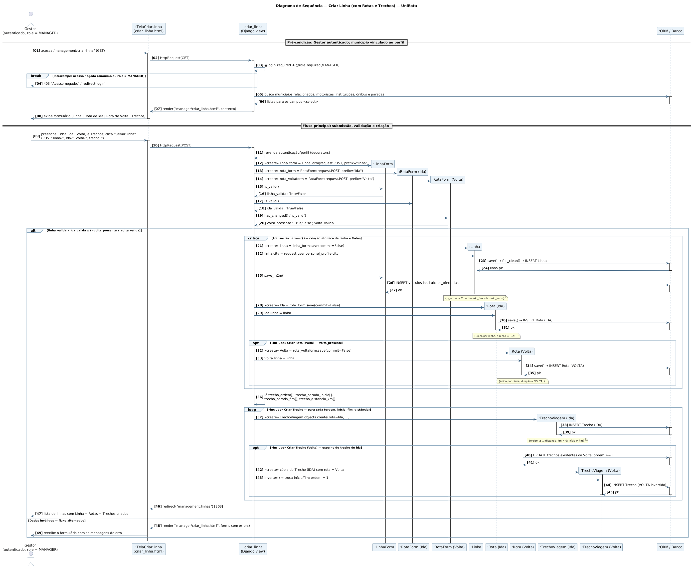

# Diagrama de Sequência — Criar Linha (UniRota)

Caso de uso **Criar Linha**, incluindo a criação das **Rotas** (Ida e, opcionalmente, Volta) e dos **Trechos** de viagem.

- Imagem: [`diagrama-sequencia-criar-linha.png`](diagrama-sequencia-criar-linha.png) · [`diagrama-sequencia-criar-linha.svg`](diagrama-sequencia-criar-linha.svg)
- Fonte editável: [`diagrama-sequencia-criar-linha.puml`](diagrama-sequencia-criar-linha.puml)



## Participantes (linhas de vida)

| Participante | Papel no sistema |
|---|---|
| `Gestor` (ator) | Usuário autenticado com `role = MANAGER` |
| `:TelaCriarLinha` | Template `manager/criar_linha.html` (formulário + JS dos trechos) |
| `:criar_linha` | View Django que coordena o caso de uso |
| `:LinhaForm`, `:RotaForm (Ida)`, `:RotaForm (Volta)` | Formulários com os prefixos `linha`, `Ida` e `Volta` |
| `:Linha`, `:Rota`, `:TrechoViagem` | Objetos de domínio criados |
| `:ORM / Banco` | Persistência Django (`save`, `save_m2m`, `objects.create`) |

## Fluxo principal

1. O Gestor acessa `GET /management/criar-linha/`; a view carrega municípios relacionados, motoristas, instituições, ônibus e paradas e renderiza o formulário.
2. O Gestor preenche os dados da **Linha**, da **Rota de Ida**, opcionalmente da **Rota de Volta** e adiciona **Trechos** (ordem, parada de início, parada de fim e distância); o formulário é enviado por `POST`.
3. A view instancia os três formulários e chama `is_valid()` / `has_changed()`.
4. Dentro de `transaction.atomic()` (**`critical`**): cria-se a `Linha` (com `city` do perfil e vínculos N:N de instituições), a `Rota` de Ida e, se informada, a `Rota` de Volta.
5. Para cada trecho enviado (**`loop`**), cria-se um `TrechoViagem` na rota de Ida; quando há volta, o trecho é replicado com paradas invertidas.
6. A view redireciona para `management:linhas`, exibindo a linha com suas rotas e trechos.

## Fluxos alternativos e de exceção (conforme o material)

| Fragmento | Situação modelada |
|---|---|
| `break` | Acesso anônimo ou perfil diferente de `MANAGER` → `403 "Acesso negado."` (ou redirect para login) — interrompe o caso de uso |
| `alt ... else` | Formulário inválido → a view renderiza novamente o formulário com `errors` |
| `opt` | Rota de Volta não informada (`has_changed() == False`) → apenas a rota de Ida é criada |
| `opt` interno | Somente com volta: trechos existentes da volta são reordenados e o trecho de ida é espelhado (`inverter()`) |
| `loop` | Repetição para cada tupla `trecho_ordem, trecho_parada_inicio, trecho_parada_fim, trecho_distancia_km` |
| `critical` | `transaction.atomic()` garante que Linha + Rotas sejam gravadas como uma única unidade |
| `<<include>>` | Criação de Rota e de Trecho são identificadas como inclusões do caso de uso `Criar Linha` |

## Notações do material utilizadas

| Notação do slide | Onde aparece no diagrama |
|---|---|
| Ator | `Gestor` |
| Linha de vida (objetos) | Tela, view, formulários, modelos e ORM |
| Mensagem de criação (`<<create>>`) | Criação de `LinhaForm`, `RotaForm`, `Linha`, `Rota` e `TrechoViagem` |
| Mensagem síncrona / retorno | Chamadas `is_valid()`, `save()`, `objects.create()` e seus retornos tracejados |
| Foco de controle / ativação | Barras de ativação nos objetos durante validação e persistência |
| Invariante de estado | `{is_active = True}`, `{ordem ≥ 1; distancia_km > 0; início ≠ fim}`, unicidade de `Rota` por direção |
| Fragmentos combinados | `alt`, `opt`, `loop`, `break` e `critical` |
| Usos de interação | Rótulos `<<include>> Criar Rota` e `<<include>> Criar Trecho` |

## Rastreabilidade no código

- `management/urls.py` → `criar-linha/`
- `management/views.py:645-715` → `criar_linha(request)`
- `management/forms.py:73-87` → `LinhaForm`, `RotaForm`, `TrechoViagemForm`
- `management/models.py:123-237` → `Linha`, `Rota`, `TrechoViagem`
- `management/templates/manager/criar_linha.html` → campos e envio dos trechos via campos ocultos
- `authentication/decorators.py:24-40` → `role_required`

## Como regenerar a imagem

Edite o `.puml` e renderize com PlantUML (local ou pelo Kroki):

```bash
curl -fsS -X POST -H 'Content-Type: text/plain' \
  --data-binary @documentacao/diagrama-sequencia-criar-linha.puml \
  https://kroki.io/plantuml/png \
  -o documentacao/diagrama-sequencia-criar-linha.png
```

> Observação de implementação: em `management/views.py:691`, `Volta` é referenciado fora do bloco que o define. O diagrama representa o fluxo pretendido pelo modelo (rota de volta opcional), conforme `has_changed()`.
